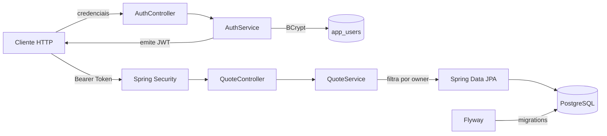
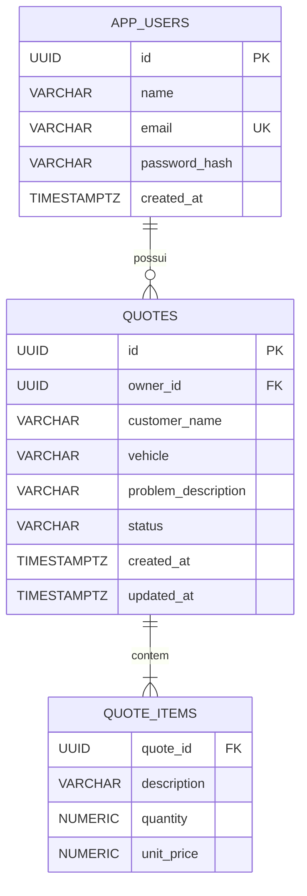

# API Orçamentos
<div align="center">

# 🔧 Orçamentos API

### Uma API REST segura para transformar diagnósticos de oficina em orçamentos claros, rastreáveis e prontos para aprovação.

[](https://openjdk.org/projects/jdk/21/)
[](https://spring.io/projects/spring-boot)
[](https://www.postgresql.org/)
[](https://www.docker.com/)

Autenticação JWT · Spring Security · JPA · Flyway · Bean Validation · Docker Compose · JUnit 5

</div>

---

## Sobre o projeto

A **Orçamentos API** é um backend para gestão de orçamentos de uma oficina mecânica. Cada usuário cria sua conta, autentica-se e administra apenas os próprios orçamentos — do rascunho até a aprovação ou recusa pelo cliente.

Mais do que um CRUD, o projeto demonstra decisões comuns em APIs de produção: autenticação stateless, isolamento de dados por usuário, valores monetários com precisão decimal, paginação, validação declarativa, migrations versionadas e ambiente reproduzível com containers.

### O que a API entrega

- Cadastro e login com e-mail normalizado;
- senhas protegidas com **BCrypt**;
- autenticação stateless com **JWT assinado em HS256**;
- CRUD completo de orçamentos;
- múltiplos itens por orçamento, com subtotal e total calculados pela API;
- ciclo de status: `DRAFT`, `SENT`, `APPROVED` e `REJECTED`;
- paginação e ordenação na listagem;
- isolamento de dados: um usuário não consulta nem altera orçamentos de outro;
- validação de payloads com respostas de erro no padrão **Problem Details**;
- versionamento do banco com **Flyway**;
- execução local completa com **Docker Compose**;
- testes unitários de autenticação, autorização por propriedade e regras de cálculo.

## Arquitetura



O código está organizado por domínio (`auth`, `quote`, `user`) e por responsabilidades compartilhadas (`config`, `common`). Controllers cuidam do contrato HTTP, services concentram regras e transações, e repositories encapsulam a persistência.

## Tecnologias e decisões técnicas

| Tecnologia | Papel no projeto |
|---|---|
| Java 21 | Plataforma e recursos modernos da linguagem |
| Spring Boot 4.1.1 | Configuração e execução da aplicação |
| Spring Web MVC | Endpoints REST e serialização JSON |
| Spring Security | Autenticação stateless e proteção das rotas |
| OAuth2 Resource Server | Validação do Bearer Token JWT |
| Spring Data JPA | Persistência e paginação |
| PostgreSQL 17 | Banco de dados relacional em produção |
| Flyway | Evolução versionada do schema |
| Bean Validation | Validação declarativa dos contratos de entrada |
| H2 | Banco em memória para testes |
| JUnit 5, Mockito e AssertJ | Testes unitários e assertions fluentes |
| Docker e Docker Compose | Build multi-stage e ambiente reproduzível |

## Como executar

### Opção 1 — Docker Compose (recomendada)

Você precisa apenas de Docker e Docker Compose.

```bash
git clone https://github.com/gattidev01/api-simples.git
cd api-simples

# Gere uma chave diferente para seu ambiente
export JWT_SECRET="$(openssl rand -base64 32)"

docker compose up --build
```

A API ficará disponível em `http://localhost:8080`. O Compose inicializa o PostgreSQL, aguarda o banco ficar saudável e só então sobe a aplicação. Os dados são preservados no volume `postgres_data`.

Para encerrar:

```bash
docker compose down
```

> O valor padrão de `JWT_SECRET` presente no Compose serve somente para desenvolvimento. Em qualquer ambiente publicado, forneça uma chave Base64 forte por variável de ambiente.

### Opção 2 — Java e Maven locais

Pré-requisitos:

- JDK 21;
- Maven 3.9+;
- PostgreSQL acessível localmente ou por uma URL configurada.

```bash
export DB_URL="jdbc:postgresql://localhost:5432/orcamentos"
export DB_USER="orcamentos"
export DB_PASSWORD="orcamentos"
export JWT_SECRET="$(openssl rand -base64 32)"

mvn spring-boot:run
```

Na inicialização, o Flyway aplica automaticamente as migrations e o Hibernate valida se o schema está compatível com as entidades.

## Variáveis de ambiente

| Variável | Valor padrão | Descrição |
|---|---|---|
| `DB_URL` | `jdbc:postgresql://localhost:5432/orcamentos` | URL JDBC do PostgreSQL |
| `DB_USER` | `orcamentos` | Usuário do banco |
| `DB_PASSWORD` | `orcamentos` | Senha do banco |
| `JWT_SECRET` | chave apenas para desenvolvimento | Segredo Base64 usado na assinatura HS256 |

O emissor do token é `orcamentos-api` e sua validade padrão é de **1 hora**.

## Referência da API

Base URL local: `http://localhost:8080`

### Autenticação

| Método | Rota | Autenticação | Descrição |
|---|---|---|---|
| `POST` | `/api/auth/register` | Pública | Cria o usuário e retorna um token (`201`) |
| `POST` | `/api/auth/login` | Pública | Autentica e retorna um token (`200`) |

### Orçamentos

Todas as rotas abaixo exigem `Authorization: Bearer <token>`.

| Método | Rota | Descrição | Sucesso |
|---|---|---|---|
| `POST` | `/api/quotes` | Cria um orçamento em `DRAFT` | `201` |
| `GET` | `/api/quotes` | Lista os orçamentos do usuário autenticado | `200` |
| `GET` | `/api/quotes/{id}` | Busca um orçamento do usuário | `200` |
| `PUT` | `/api/quotes/{id}` | Substitui os dados e itens do orçamento | `200` |
| `PATCH` | `/api/quotes/{id}/status` | Altera o status do orçamento | `200` |
| `DELETE` | `/api/quotes/{id}` | Exclui o orçamento | `204` |

### Paginação e ordenação

A listagem utiliza o padrão de paginação do Spring Data:

```http
GET /api/quotes?page=0&size=10&sort=createdAt,desc
```

Sem parâmetros, a página possui 20 registros e é ordenada por `createdAt`.

## Experimente a jornada completa

### 1. Criar uma conta

```bash
curl -i -X POST http://localhost:8080/api/auth/register \
  -H 'Content-Type: application/json' \
  -d '{
    "name": "Ana Souza",
    "email": "ana@oficina.com",
    "password": "senha-segura"
  }'
```

Resposta:

```json
{
  "accessToken": "eyJhbGciOiJIUzI1NiJ9...",
  "tokenType": "Bearer",
  "expiresInSeconds": 3600
}
```

### 2. Autenticar

```bash
curl -X POST http://localhost:8080/api/auth/login \
  -H 'Content-Type: application/json' \
  -d '{
    "email": "ana@oficina.com",
    "password": "senha-segura"
  }'
```

Copie o `accessToken` retornado e defina-o para os próximos exemplos:

```bash
export TOKEN='cole-o-token-aqui'
```

### 3. Criar um orçamento

```bash
curl -X POST http://localhost:8080/api/quotes \
  -H "Authorization: Bearer $TOKEN" \
  -H 'Content-Type: application/json' \
  -d '{
    "customerName": "Carlos Lima",
    "vehicle": "Honda Civic 2020",
    "problemDescription": "Ruído ao frear e revisão preventiva",
    "items": [
      {
        "description": "Jogo de pastilhas de freio",
        "quantity": 1,
        "unitPrice": 280.00
      },
      {
        "description": "Mão de obra",
        "quantity": 2,
        "unitPrice": 90.00
      }
    ]
  }'
```

Resposta representativa:

```json
{
  "id": "ad7bbb91-70af-45d4-ae50-62b22de75bb5",
  "customerName": "Carlos Lima",
  "vehicle": "Honda Civic 2020",
  "problemDescription": "Ruído ao frear e revisão preventiva",
  "items": [
    {
      "description": "Jogo de pastilhas de freio",
      "quantity": 1,
      "unitPrice": 280.00,
      "subtotal": 280.00
    },
    {
      "description": "Mão de obra",
      "quantity": 2,
      "unitPrice": 90.00,
      "subtotal": 180.00
    }
  ],
  "total": 460.00,
  "status": "DRAFT",
  "createdAt": "2026-10-06T18:30:00Z",
  "updatedAt": "2026-10-06T18:30:00Z"
}
```

### 4. Avançar o status

```bash
curl -X PATCH http://localhost:8080/api/quotes/ad7bbb91-70af-45d4-ae50-62b22de75bb5/status \
  -H "Authorization: Bearer $TOKEN" \
  -H 'Content-Type: application/json' \
  -d '{"status": "SENT"}'
```

Status aceitos:

```text
DRAFT → orçamento em elaboração
SENT → orçamento enviado ao cliente
APPROVED → orçamento aprovado
REJECTED → orçamento recusado
```

## Validações e erros

Os principais limites do contrato são:

- nome do usuário: até 120 caracteres;
- senha: entre 8 e 72 caracteres;
- cliente e veículo: até 120 caracteres;
- descrição do problema: até 1.000 caracteres;
- orçamento: entre 1 e 50 itens;
- descrição do item: até 180 caracteres;
- quantidade: maior ou igual a `0.01`;
- preço unitário: maior ou igual a zero.

Erros de validação retornam `400 Bad Request` no formato Problem Details, incluindo os campos inválidos:

```json
{
  "type": "about:blank",
  "title": "Bad Request",
  "status": 400,
  "detail": "Existem campos inválidos na requisição",
  "errors": {
    "customerName": "must not be blank"
  }
}
```

Outros retornos relevantes:

| Status | Quando ocorre |
|---|---|
| `401 Unauthorized` | Token ausente, inválido ou credenciais incorretas |
| `404 Not Found` | Orçamento inexistente ou pertencente a outro usuário |
| `409 Conflict` | Já existe uma conta com o e-mail informado |

Retornar `404` também para recursos de outro proprietário evita revelar a existência de dados de terceiros.

## Modelo de dados



Os itens pertencem ao agregado `Quote` e são removidos em cascata com o orçamento. Índices em `owner_id` e `quote_id` favorecem as consultas mais frequentes.

## Estrutura do projeto

```text
src
├── main
│   ├── java/com/gattidev/orcamentos
│   │   ├── auth/       # cadastro, login e emissão de JWT
│   │   ├── common/     # exceções e tratamento global de erros
│   │   ├── config/     # configuração do Spring Security
│   │   ├── quote/      # domínio, DTOs, controller, service e repository
│   │   └── user/       # entidade e repository de usuários
│   └── resources
│       ├── db/migration/  # migrations Flyway
│       └── application.yml
└── test
    ├── java/              # testes unitários
    └── resources/         # configuração H2 de testes
```

## Testes

Execute a suíte com:

```bash
mvn test
```

Os testes existentes verificam:

- normalização de e-mail e hash da senha no cadastro;
- rejeição de e-mail duplicado;
- criação de orçamento para o proprietário autenticado;
- proteção contra acesso ao orçamento de outro usuário;
- cálculo do total a partir de múltiplos itens e status inicial `DRAFT`.

## Segurança

- API stateless, sem sessão no servidor;
- senhas armazenadas exclusivamente como hash BCrypt;
- JWT assinado com HS256 e expiração configurada;
- todas as rotas de orçamento protegidas;
- consultas ao banco filtradas simultaneamente por ID e proprietário;
- CSRF desabilitado por se tratar de uma API Bearer Token stateless;
- aplicação executada no container com usuário não privilegiado.

## Próximos passos

- Documentação interativa com OpenAPI/Swagger;
- testes de integração com Testcontainers;
- regras explícitas de transição entre status;
- observabilidade com Actuator, métricas e tracing;
- pipeline de CI para build, testes e análise estática;
- filtros de busca por cliente, veículo, status e período.

---

<div align="center">

Desenvolvido por [gattidev01](https://github.com/gattidev01) como demonstração de uma API Java moderna, segura e pronta para evoluir.

</div>
