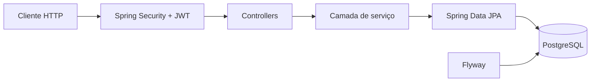

# Orçamentos API

API REST para gerenciar orçamentos de uma oficina. Este projeto transforma um problema de negócio que conheço em uma demonstração prática de **Java, Spring Boot, segurança, persistência e testes**.

## O que o projeto demonstra

- Java 21 e Spring Boot 4
- API REST com validação de entrada e respostas de erro padronizadas
- autenticação stateless com Spring Security e JWT
- autorização por proprietário: cada usuário acessa apenas os próprios orçamentos
- persistência com Spring Data JPA e PostgreSQL
- versionamento do banco com Flyway
- testes de domínio e de serviços com JUnit, AssertJ e Mockito
- CI com GitHub Actions
- ambiente local com Docker Compose

## Arquitetura



O código está organizado por domínio (`auth`, `quote` e `user`). Controllers cuidam do protocolo HTTP, services concentram as regras de negócio e repositories isolam a persistência.

## Decisões técnicas

- **JWT stateless:** evita sessão no servidor e protege todos os endpoints de orçamento.
- **Isolamento por proprietário:** as consultas sempre combinam o ID do orçamento com o e-mail autenticado, evitando acesso horizontal aos dados de outra conta.
- **DTOs separados das entidades:** impede que o contrato HTTP exponha diretamente o modelo do banco.
- **Valores com `BigDecimal`:** evita erros de ponto flutuante em cálculos monetários.
- **Migrações Flyway:** o schema pode evoluir de forma rastreável e reproduzível.
- **Problem Details:** erros seguem o formato padronizado pelo Spring (`application/problem+json`).

## Endpoints

| Método | Rota | Autenticação | Descrição |
|---|---|---:|---|
| `POST` | `/api/auth/register` | Não | Cria uma conta e retorna o token |
| `POST` | `/api/auth/login` | Não | Autentica e retorna o token |
| `POST` | `/api/quotes` | Sim | Cria um orçamento |
| `GET` | `/api/quotes` | Sim | Lista os próprios orçamentos com paginação |
| `GET` | `/api/quotes/{id}` | Sim | Busca um orçamento |
| `PUT` | `/api/quotes/{id}` | Sim | Atualiza dados e itens |
| `PATCH` | `/api/quotes/{id}/status` | Sim | Altera o status |
| `DELETE` | `/api/quotes/{id}` | Sim | Exclui um orçamento |

## Como executar

Pré-requisitos: Java 21, Maven 3.9+ e PostgreSQL. A forma mais simples é usar Docker:

```bash
docker compose up --build
```

A API ficará disponível em `http://localhost:8080`.

Para executar sem Docker:

```bash
export DB_URL=jdbc:postgresql://localhost:5432/orcamentos
export DB_USER=orcamentos
export DB_PASSWORD=orcamentos
export JWT_SECRET='uma-chave-base64-com-pelo-menos-32-bytes'
mvn spring-boot:run
```

> O segredo padrão existe apenas para facilitar o desenvolvimento local. Em produção, use um valor forte fornecido por variável de ambiente.

## Exemplo de uso

Crie uma conta:

```bash
curl -X POST http://localhost:8080/api/auth/register \
  -H 'Content-Type: application/json' \
  -d '{"name":"Natália","email":"natalia@example.com","password":"senha-segura"}'
```

Use o `accessToken` retornado para criar um orçamento:

```bash
curl -X POST http://localhost:8080/api/quotes \
  -H 'Content-Type: application/json' \
  -H 'Authorization: Bearer SEU_TOKEN' \
  -d '{
    "customerName": "Cliente Teste",
    "vehicle": "Honda Civic 2020",
    "problemDescription": "Revisão preventiva",
    "items": [
      {"description":"Óleo do motor","quantity":4,"unitPrice":35.50},
      {"description":"Mão de obra","quantity":1,"unitPrice":180.00}
    ]
  }'
```

## Testes

```bash
mvn verify
```

Os testes cobrem cálculo do total, criação de orçamento, isolamento entre usuários, normalização de e-mail, hash de senha e conflito de cadastro.

## Próximas evoluções

- testes de integração HTTP com Testcontainers
- documentação OpenAPI
- regras explícitas de transição entre status
- auditoria de alterações nos orçamentos

---

Feito por [Natália Gatti](https://github.com/gattidev01) como projeto de portfólio Java/Spring Boot.
